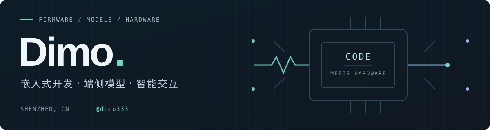
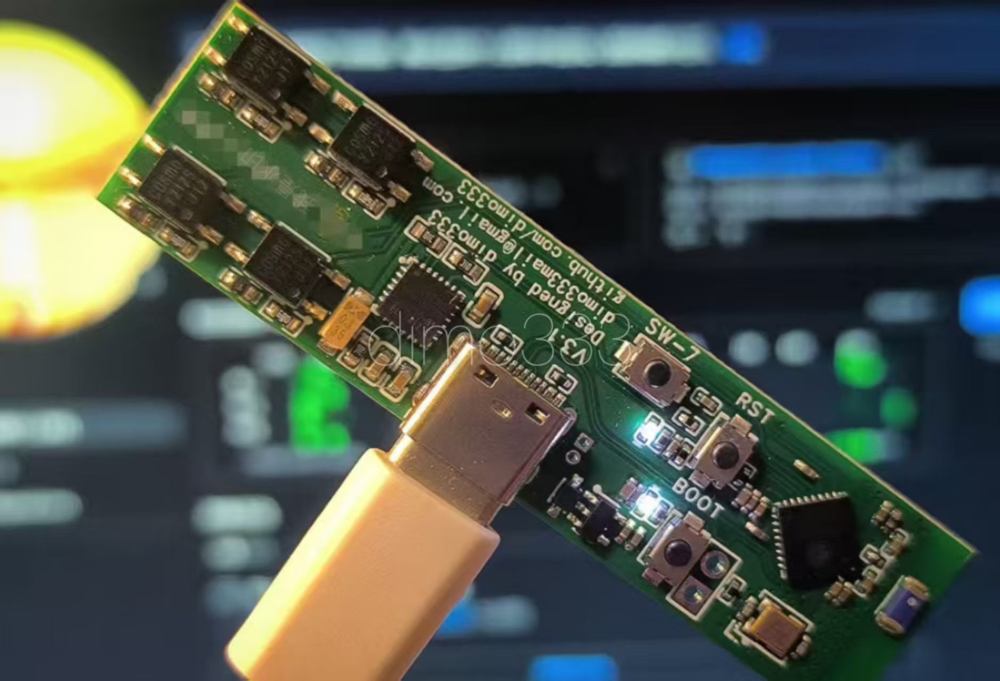

  

  <a href="https://github.com/dimo333/Electromagic_Wand_ESP32">赛博魔杖</a> ·
  <a href="https://oshwhub.com/6dimo9/electromagic_wand_esp32">开源硬件</a> ·
  <a href="https://www.bilibili.com/video/BV1NtwreXEzg">项目演示</a> ·
  <a href="mailto:dimo333mail@gmail.com">联系我</a>

我是 **Dimo**，深圳的嵌入式软件工程师，机器人工程背景。

主要做 **ESP32 固件、图像处理和端侧模型部署**，也维护一些可以动手复刻的开源硬件项目。喜欢把传感器数据变成有意思的交互，让自己写的代码在真实设备上跑起来。

## 代表项目

### [Electromagic Wand ESP32 · 赛博魔杖](https://github.com/dimo333/Electromagic_Wand_ESP32)

**挥动魔杖，用手势控制现实中的设备。**

  

基于 **ESP32 + MPU6050 + TensorFlow Lite Micro** 的手势识别电子魔杖。从 IMU 数据采集、模型训练到 MCU 本地推理，提供完整的上手资料与实现代码。

- **可训练的手势交互**：采集自己的动作数据，训练并部署自定义手势模型。
- **可扩展的设备联动**：提供红外、BLE 和 Wi-Fi 相关示例，探索遥控、键鼠与智能家居交互。
- **可复刻的软硬件**：提供 Arduino / ESP-IDF 两套工程，以及 PCB、3D 外壳和教程。

**项目累计量产 4,000+ 件 · 完成 10+ 项定制开发**

[源代码](https://github.com/dimo333/Electromagic_Wand_ESP32) · [硬件资料](https://oshwhub.com/6dimo9/electromagic_wand_esp32) · [复刻教程](https://github.com/dimo333/Electromagic_Wand_ESP32/tree/main/docs/tutorial) · [视频演示](https://www.bilibili.com/video/BV1NtwreXEzg)

## 产品研发

开源之外，我也参与消费电子产品的固件开发、功能联调与量产落地。

**[Bloomin8 · 多色墨水屏相框](https://bloomin8.com/products/bloomin8-eink-canvas)**

参与 13.3 / 28.5 英寸产品开发，负责图片传输与文件管理、图像裁切与多色抖点处理，以及 OTA、低功耗优化。产品累计量产 **4,500+ 件**。

**[TRYX · STAGE-360 双屏水冷显示设备](https://shop.tryx.com/products/tryx-stage360)**

参与 RK3566 平台开发，完成 Protobuf 适配、瑞芯微烧录工具 Windows 移植及图片、视频资源加解密。

**TRYX · nRF52840 三模键盘研发**

参与研发阶段的 RGB 灯效、键位分层与宏回放开发：SPI + EasyDMA 灯效输出、矩阵扫描、Fn 切层及按键事件调度。

## 更多开源与贡献

| 项目 | 内容 |
| :--- | :--- |
| [TM1026 指纹模块资料](https://github.com/dimo333/Fingerprint_module_TM1026) | 整理模块规格书、通信协议与串口调试工具，补充使用说明，方便快速接入。 |
| [Seeed Studio Wiki](https://github.com/Seeed-Studio/wiki-documents/pulls?q=is%3Apr+author%3Adimo333+is%3Amerged) | 参与 reTerminal 与 XIAO 系列电子纸产品文档维护，修改内容已合入官方仓库。 |
| [ZMK 键盘配置](https://github.com/dimo333/zmk) | 基于上游固件调整键位、功能层与组合键，探索分体键盘的交互配置。 |

## 常用技术

| 方向 | 技术与平台 |
| :--- | :--- |
| 嵌入式开发 | C / C++ · ESP32 · nRF52840 · RK3566 · ESP-IDF · FreeRTOS |
| 模型与图像 | Python · TensorFlow / TFLite Micro · OpenCV · 图像抖点 |
| 设备与通信 | IMU · I²C / SPI / UART · BLE / Wi-Fi · USB HID |
| 工程实践 | Git · 固件移植 · OTA · 低功耗调试 · 软硬件联调 |

  
GitHub 贡献记录

   
  <picture>
    <source media="(prefers-color-scheme: dark)" srcset="https://raw.githubusercontent.com/dimo333/dimo333/snake/snake-dark.svg" />
    
  </picture>

---

欢迎交流嵌入式开发、端侧模型与开源硬件，也欢迎分享你的魔杖复刻和改进。

**[dimo333mail@gmail.com](mailto:dimo333mail@gmail.com)**
